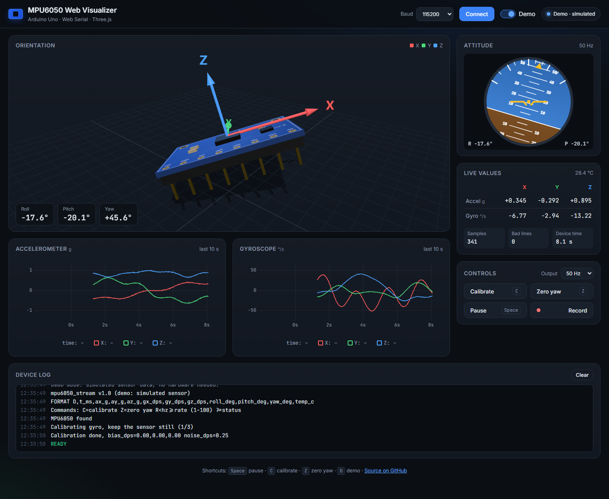
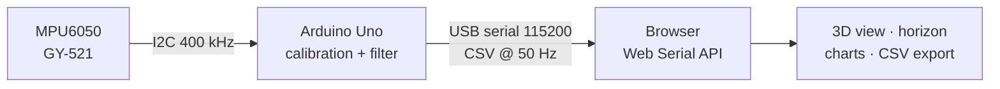
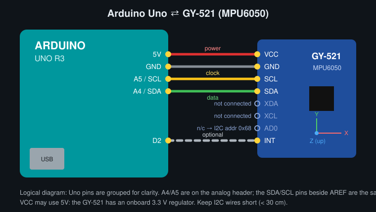

# MPU6050 Web Visualizer

See an MPU6050's motion live in your browser. An Arduino Uno reads the sensor and sends the data over USB. The web page shows it with **Web Serial**, as a 3D board, an artificial horizon and live charts. There is no server or app to install.

[](https://jayashankaanushan19.github.io/mpu6050-web-visualizer/?demo)




> **Try it now:** open the [live demo](https://jayashankaanushan19.github.io/mpu6050-web-visualizer/?demo). Demo mode makes up realistic sensor data, so no hardware is needed.

---

## Features

- **3D view**: a GY-521 board with X/Y/Z arrows that turns with roll, pitch and yaw. Drag to orbit, scroll to zoom.
- **Artificial horizon**: an aircraft-style display of roll and pitch.
- **Live charts**: accelerometer and gyroscope X/Y/Z over the last 10 seconds (X red, Y green, Z blue).
- **Live values**: all readings, temperature, sample rate and a count of bad lines.
- **Controls**: Calibrate, Zero yaw, Pause, an output rate of 10–100 Hz, and Record to CSV.
- **Demo mode**: a built-in simulator that sends the same serial protocol as the firmware.
- **Robust serial handling**: partial lines are buffered, malformed lines are skipped, and an unplugged cable is detected.
- **Shortcuts**: <kbd>Space</kbd> pause · <kbd>C</kbd> calibrate · <kbd>Z</kbd> zero yaw · <kbd>D</kbd> demo.
- **Lightweight firmware**: no libraries except `Wire`, no `String` class, and output paced with `millis()`.

## How it works



The Uno reads the sensor at 200 Hz, removes the gyro bias and runs a complementary filter. It then sends one CSV line per sample. The page is static HTML/JS with no build step, so it runs from `localhost` or GitHub Pages.

## Hardware

| Part | Notes |
|------|-------|
| Arduino Uno (or compatible) | ATmega328P |
| GY-521 breakout (MPU6050) | Clones with an MPU6500-family chip also work (see below) |
| 4–5 jumper wires | Keep them short |
| USB cable | Type-B for the Uno |

## Wiring

| GY-521 | Arduino Uno | Notes |
|--------|-------------|-------|
| VCC | **5V** | The board has its own 3.3 V regulator |
| GND | **GND** | |
| SCL | **A5** | Also on the SCL pin next to AREF |
| SDA | **A4** | Also on the SDA pin next to AREF |
| INT | D2 | Optional, not used yet |
| AD0, XDA, XCL | not connected | AD0 not connected gives address 0x68 |



> **Tip:** solder the header pins to the GY-521. Pins pushed into the holes without solder cause random "sensor not found" errors.

## Getting started

### 1. Flash the Arduino

**Arduino IDE:** open [`firmware/mpu6050_stream/mpu6050_stream.ino`](firmware/mpu6050_stream/mpu6050_stream.ino), select **Arduino Uno** and your COM port, then click **Upload**.

**or PlatformIO:** from the repo root, run

```bash
pio run -t upload
```

To check it, open the Serial Monitor at 115200 baud. You should see `#READY`, then `D,...` lines. **Close the Serial Monitor afterwards**, because only one program can use the port.

### 2. Open the web app

**Windows (easiest):** double-click **`start.bat`**.

It starts a small local server (nothing to install) and opens the app in Chrome or Edge at `http://localhost:8000`. Use `start.bat demo` to open it in demo mode.

**Any OS:** serve the `web/` folder with any static server, for example:

```bash
cd web
python -m http.server 8000
# then open http://localhost:8000 in Chrome or Edge
```

> Opening `index.html` directly (`file://`) won't work. ES modules and Web Serial need `http://localhost` or `https://`.

### 3. Connect

1. Click **Connect** and choose the Arduino's port. It usually shows as "USB-SERIAL CH340" or "Arduino Uno".
2. **Keep the sensor still for about 3 seconds.** Opening the port restarts the Uno, and it calibrates the gyro on every start.
3. Move the sensor. Use **Zero yaw** to make the current direction "forward".

### GitHub Pages

The workflow in [`.github/workflows/pages.yml`](.github/workflows/pages.yml) publishes the `web/` folder on every push to `main`. To turn it on (once): **Settings → Pages → Source: GitHub Actions**.

## Serial protocol

```
D,<t_ms>,<ax>,<ay>,<az>,<gx>,<gy>,<gz>,<roll>,<pitch>,<yaw>,<tempC>
```

Units: g, °/s, degrees, °C. Lines starting with `#` are status messages (`#READY`, `#OK`, `#WARN`, `#ERROR`, `#INFO`).

| Command | Action |
|---------|--------|
| `C` | Recalibrate the gyro (keep still) |
| `Z` | Zero the yaw |
| `R<hz>` | Set the output rate, 1–100 Hz (e.g. `R25`) |
| `?` | Show the current settings |

Full details are in [docs/protocol.md](docs/protocol.md).

## How roll, pitch and yaw are computed

**The two sensors are good at different things:**

- The **gyroscope** measures how fast the board is rotating. Adding up (integrating) those readings gives smooth, fast angles, but small errors build up and the angle slowly **drifts**.
- The **accelerometer** detects gravity, so it knows which way is down. It gives an absolute tilt, but it is **noisy** and confused by any movement.

**A complementary filter combines them:**

```
angle = 0.98 × (angle + gyro_rate × dt)  +  0.02 × accel_angle
```

Each step trusts the gyro 98% for quick changes. The 2% from the accelerometer slowly pulls the angle back to the true tilt, which removes the drift. The filter runs at a fixed 200 Hz, separate from the output rate.

**Why yaw drifts:** yaw is rotation around the vertical axis. Gravity is the same at every heading, so the accelerometer can't correct yaw. The MPU6050 has no magnetometer (compass), so nothing measures absolute heading. Yaw comes from the gyro alone and slowly drifts, typically a few degrees per minute after calibration. Press **Zero yaw** to reset it.

Two other limits:
- Accelerometer angles are only correct when the board isn't accelerating.
- Euler angles become unstable near ±90° pitch (gimbal lock).

## Project structure

```
mpu6050-web-visualizer/
├── firmware/mpu6050_stream/
│   └── mpu6050_stream.ino   Arduino sketch (also built by PlatformIO)
├── web/                     Static web app (deployed to GitHub Pages)
│   ├── index.html
│   ├── css/style.css
│   └── js/
│       ├── main.js          App wiring, UI, render loop
│       ├── serial.js        Web Serial connection
│       ├── parser.js        Line splitting and protocol parsing
│       ├── demo.js          Simulated sensor (same protocol)
│       ├── scene3d.js       Three.js board model
│       ├── horizon.js       Artificial horizon (canvas)
│       ├── charts.js        Rolling uPlot charts
│       └── recorder.js      CSV recording/export
├── docs/                    Wiring diagram, protocol, screenshot
├── tools/serve.ps1          Local web server used by start.bat
├── start.bat                One-click launcher (Windows)
├── platformio.ini
└── .github/workflows/pages.yml
```

## Troubleshooting

| Problem | Fix |
|---------|-----|
| `#ERROR MPU6050 not found at 0x68` | Check the wiring (SDA→A4, SCL→A5, VCC, GND). Solder the header pins. Use shorter wires. |
| `#WARN WHO_AM_I is 0x70` (or 0x71, 0x98…) | Your board has an MPU6500-family clone chip. It is supported, and the firmware adjusts automatically. |
| "Port is busy" when connecting | Close the Arduino Serial Monitor/Plotter, Cura, or any other app using the COM port. |
| No port in the list, or the wrong port | Try another USB cable (some are charge-only). Install the CH340 driver for clone Unos. Look under Device Manager → Ports. |
| Connect button disabled / yellow banner | Web Serial only works in **desktop Chrome or Edge**. Use Demo mode elsewhere. |
| Page is blank | Use `start.bat` or a local server, not `file://`. Check that you are online, because Three.js and uPlot load from a CDN. |
| Yaw keeps turning slowly | Normal (see above). Press **Calibrate** with the board still, then **Zero yaw**. |
| `#WARN Movement detected during calibration` | Leave the board flat and still while it calibrates, then press **Calibrate**. |
| Upload fails in the Arduino IDE | Disconnect the web app first, because it holds the port. |

## Future ideas

- **ESP32 version** that streams over WiFi with WebSockets, without a USB cable
- **Magnetometer** (MPU9250 or QMC5883L) for yaw that doesn't drift
- **Madgwick / Mahony filter** with quaternions, so there's no gimbal lock
- **Multiple sensors** on one page (e.g. a second sensor at address 0x69)
- One-time accelerometer calibration to remove the factory offset

## License

[MIT](LICENSE)
