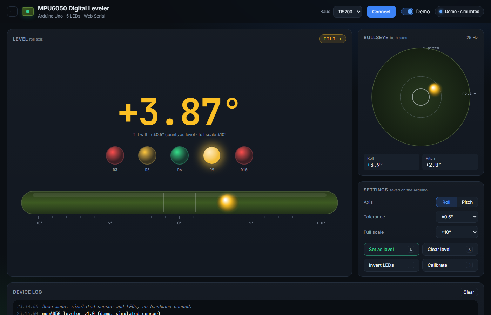
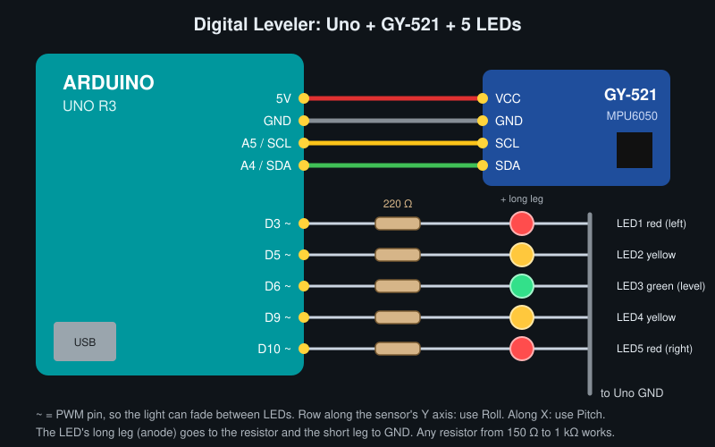

# MPU6050 Digital Leveler

> Project 2 of [MPU6050 Projects](../README.md). See also the [Motion Visualizer](../visualizer/README.md).

A digital spirit level made from an Arduino Uno, an MPU6050 and **five LEDs**. Tilt the board and the light glides along the LED row like the bubble in a level. When it's level, only the **green centre LED** is lit. The same data streams over USB, so the web page can mirror the LEDs live and add a vial and a bullseye.

[](https://jayashankaanushan19.github.io/mpu6050-web-visualizer/leveler/web/?demo)



---

## Features

- **Works on its own:** the LEDs show level with or without a computer. Power it from USB or a power bank.
- **Smooth bubble:** all five LEDs are on PWM pins, so the light fades between neighbours instead of jumping.
- **Set as level:** press **L** to make any surface the reference, e.g. to match an existing shelf.
- **Settings saved in EEPROM:** the axis, tolerance, full scale, direction and level reference all survive a power cycle.
- **Web app:** a big angle readout, the five LEDs mirrored live, a tube vial, a two-axis bullseye and all settings as buttons.
- **Demo mode:** a simulated leveler with the same protocol and LED logic.
- **Self-test:** at power-on the LEDs sweep left to right and back, so a wiring fault shows straight away.

## How the LEDs behave

| Tilt | LEDs |
|------|------|
| Within ± tolerance (default 0.5°) | 🟢 centre only |
| Tolerance to full scale (default 10°) | the light moves 🟢 → 🟡 → 🔴, fading between LEDs |
| Past full scale | the outer 🔴 blinks |
| Calibrating (keep still) | both 🟡 on |
| Sensor not found | both 🔴 blink |

## Hardware

| Part | Qty |
|------|-----|
| Arduino Uno | 1 |
| GY-521 (MPU6050) | 1 |
| 5 mm LEDs: red, yellow, green, yellow, red | 5 |
| 220 Ω resistors (150 Ω–1 kΩ works) | 5 |
| Breadboard + jumper wires | |

## Wiring

| From | To |
|------|----|
| GY-521 VCC / GND | 5V / GND |
| GY-521 SCL / SDA | A5 / A4 |
| D3 → 220 Ω → LED1 red (left) | LED cathode → GND |
| D5 → 220 Ω → LED2 yellow | LED cathode → GND |
| D6 → 220 Ω → LED3 green (centre) | LED cathode → GND |
| D9 → 220 Ω → LED4 yellow | LED cathode → GND |
| D10 → 220 Ω → LED5 red (right) | LED cathode → GND |



The LED's **long leg** (anode) goes to the resistor. Fix the sensor flat and put the LED row along one of its axes. A row along the sensor's **Y** axis uses **Roll**, and a row along **X** uses **Pitch**. If the light moves the wrong way, press **Invert LEDs**.

## Getting started

1. **Upload** [`firmware/mpu6050_leveler/mpu6050_leveler.ino`](firmware/mpu6050_leveler/mpu6050_leveler.ino) with the Arduino IDE (board: Arduino Uno). With PlatformIO, run `cd leveler && pio run -t upload` instead.
2. **Watch the LEDs.** They sweep once, then both yellows light while the gyro calibrates (keep it still for about 2 s). After that it's live.
3. **Set the reference.** Put it on a surface you know is level, or one you want to match, and send **L**. Use the web app button or type `L` in the Serial Monitor.
4. **Optional web view:** close the Serial Monitor, double-click `start.bat` in the repo root, choose **Digital Leveler** and click **Connect**. You can also run `start.bat leveler`.

## Commands

| Command | Action |
|---------|--------|
| `L` | Save the current position as level |
| `X` | Clear the level reference |
| `A`, `AR`, `AP` | Switch axis, or pick roll or pitch |
| `I` | Invert the LED direction |
| `T0.5` | Tolerance in degrees (0.1–5.0) |
| `S10` | Full scale in degrees (2–45) |
| `C` | Recalibrate the gyro |
| `R25` | Output rate in Hz (1–50) |
| `?` | Status and settings |

The full protocol is in [docs/protocol.md](docs/protocol.md).

## How it works

The firmware reads the MPU6050 at 200 Hz and runs the same **complementary filter** as the [visualizer](../visualizer/README.md#how-roll-pitch-and-yaw-are-computed). The accelerometer gives the true tilt from gravity, and the gyro smooths out hand shake and vibration. Yaw isn't needed, so it doesn't drift.

The LED position is computed from the angle:

```
|angle| ≤ tol            → centre LED
tol < |angle| < range    → pos = ±(0.5 + 1.5 × (|angle| − tol) / (range − tol))    (−2 … +2)
LED i brightness         = 255 × max(0, 1 − |pos − i|)²
```

Squaring the brightness makes the fade look even to the eye. A little **hysteresis** stops the centre LED flickering at the edge of the tolerance: once level, it stays level until the tilt passes `tol × 1.15`.

**Accuracy:** with the level reference set, expect about ±0.1–0.2°. The accelerometer has a small factory offset, so press **L** on a known-level surface rather than trusting the sensor's raw zero.

## Troubleshooting

| Problem | Fix |
|---------|-----|
| One LED never lights | Check its polarity (long leg to the resistor) and its pin. The power-on sweep shows which one is missing. |
| Both red LEDs blink | The sensor isn't found. Check SDA→A4 and SCL→A5, and solder the GY-521 header pins. |
| The light moves the wrong way | Press **Invert LEDs** (`I`). |
| It responds to the wrong tilt | Switch the axis (`A`). |
| Never shows level on a flat table | Press **Set as level** (`L`), or raise the tolerance (`T1`). |

## Project structure

```
leveler/
├── firmware/mpu6050_leveler/mpu6050_leveler.ino   Arduino sketch
├── web/
│   ├── index.html
│   ├── css/style.css
│   └── js/
│       ├── main.js      UI wiring and render loop
│       ├── gauges.js    Vial and bullseye (canvas)
│       ├── demo.js      Simulated leveler (same protocol and LED logic)
│       ├── parser.js    Protocol parsing
│       └── serial.js    Web Serial connection
├── docs/                Wiring diagram, protocol, screenshot
└── platformio.ini
```

## License

[MIT](../LICENSE)
